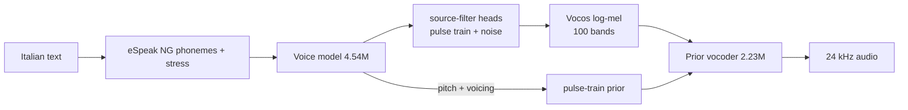

# tiny-voca-it

tiny-voca-it is a small **Italian** text-to-speech model: about **6.8M parameters**
in total, two voices (Lorenzo, male; Chiara, female), an emotion control, and a neural vocoder. It runs on a CPU and
in the browser.

It started as a fork of [tiny-voca](https://github.com/n4ze3m/tiny-voca), a 4.5M
two-voice English model, and has been rebuilt around Italian.

[Browser preview](https://carbogninalberto.github.io/tiny-voca-it/) ·
[Architecture](docs/architecture.md) · [Quality journey](docs/analysis/quality-journey.md) ·
[Italian pipeline](docs/italian.md)

> **Status (November 2026): work in progress.** Speech is intelligible and natural
> in rhythm and pitch. A slight metallic trace remains on some voices; the current
> work targets it (see [Quality journey](docs/analysis/quality-journey.md)).

## What's inside



| Part | Parameters | What it does |
|---|---|---|
| Voice model (`tiny_voca.model.TinyVoca`) | 4.54M | Transformer encoder, duration and pause predictor, prosody stack (pitch, voicing, energy), acoustic stack, source-filter heads that render an intermediate waveform |
| Neural vocoder (`tiny_voca.vocoder.Vocoder`) | 2.23M | Vocos-style ConvNeXt + inverse STFT; its phase starts from a pulse train built from the predicted pitch (the "harmonic prior") plus a learned correction |
| **Total** | **6.77M** | About 27 MB in fp32 |

**Improvements over the English original:**

- **Italian front end:** an Italian eSpeak NG profile with stress and geminates, and
  a JavaScript port for the browser that matches the Python front end exactly.
- **Two voices:**
  - **Lorenzo** (`EM4`, male): soft, warm, medium-low.
  - **Chiara** (`EF4`, female): calm, assured, low.
  - Both are designed voices: 5 hours of speech each plus about 1,000 emotional clips,
    generated with Qwen3-TTS and screened with Whisper and a voice-similarity check.
    Their audio is synthetic.
  - The model was pre-trained on 12 voices (CML-TTS readers and synthetic emotional
    voices), then fine-tuned on these two.
- **Emotion control:** neutral, joy, sadness, anger, fear, surprise, disgust, each
  with an intensity (0–1.5). Implemented as intensity × a learned vector, so it costs
  about 3k parameters. It works best on the EF/EM voices.
- **Harmonic-prior neural vocoder:**
  - It replaces the old pure-DSP output, which sounded buzzy.
  - Taking its phase from a pulse train fixes the metallic phase errors of a plain
    small vocoder at a fraction of the size.
  - Training: distilled from Vocos on spectrum level, plus adversarial and
    feature-matching losses.
- **Training additions:**
  - **Adversarial fine-tuning of the voice model,** including a critic on the
    spectrogram the vocoder reads.
  - **A pitch-spread loss** against monotone speech.
  - **Several manifests per run,** and a GPU utilisation/power governor.
- **One ONNX graph:** voice model + neural vocoder export to a single file that runs
  in ONNX Runtime and ONNX Runtime Web.

The design choices, numbers and failed attempts are documented in
[docs/architecture.md](docs/architecture.md) and
[docs/analysis/quality-journey.md](docs/analysis/quality-journey.md).

## Benchmark

On the Italian split of the public [MiniMax TTS Multilingual Test Set](https://huggingface.co/datasets/MiniMaxAI/TTS-Multilingual-Test-Set)
(100 sentences, Whisper-large-v3), tiny-voca-it scores **0.54% WER** (CER 0.33%; 95% interval 0.20–0.96%). The published systems
on the same set range from 0.95% (Qwen3-TTS 1.7B) to 2.16%.

- **Not the same task:** those systems clone voices zero-shot.
- **Speed:** 22× real time on one CPU thread, 79× on a GPU.
- **Full table and caveats:** [docs/benchmarks/minimax-it](docs/benchmarks/minimax-it/README.md).

## Install

```bash
git clone https://github.com/carbogninalberto/tiny-voca-it.git
cd tiny-voca-it
pip install -e ".[prepare,annotate,evaluate]" onnx onnxruntime
```

You need eSpeak NG 1.51 with the `it` voice on `PATH`; see
[docs/italian.md](docs/italian.md).

## Usage

```bash
python -m tiny_voca.infer \
  --checkpoint runs/voice-four/inference-135000.pt \
  --vocoder runs/vocoder-four/vocoder-voicegain.pt \
  --voice EM4 \
  --text "Buongiorno! Come stai oggi?" \
  --output ciao.wav
```

| Option | Default | Meaning |
|---|---|---|
| `--voice` | first voice | `EM4` (Lorenzo) or `EF4` (Chiara) |
| `--vocoder` | none | Neural vocoder checkpoint. Without it you get the old source-filter output |
| `--emotion` / `--intensity` | none / 1.0 | e.g. `--emotion joy --intensity 0.8` |
| `--speed` | 1.0 | Speaking rate |
| `--pitch-shift` | 0 | Added to log F0 (0.058 is about one semitone) |
| `--pitch-range` | 1.0 | More or less pitch movement |

The model reads one sentence at a time. Split long text first.

The checkpoints of the current models are not published yet. The released
single-voice checkpoints from the first Italian round are in `models/italian/`.

## Playgrounds

- **Browser preview** (no server, runs locally in your browser):
  <https://carbogninalberto.github.io/tiny-voca-it/>.
  - Build it with `bash scripts/build_pages.sh`.
  - Set `PREVIEW_VOICE` / `PREVIEW_VOCODER` to add a work-in-progress model.
- **Local playground** with hot reload of the newest checkpoints, a vocoder choice,
  emotion and 20 difficult test sentences:
  `python scripts/playground_server.py --model <inference.pt ...> --vocoder <vocoder.pt ...> --port 8790`.

## ONNX

```bash
python -m tiny_voca.export --checkpoint <inference.pt> --vocoder <vocoder.pt> --output tiny-voca-it.onnx
```

**Inputs:**

- `tokens`, `stress`;
- `voice`, `speed`, `pitch_shift`, `pitch_range`;
- for emotional models, also `emotion` and `intensity`.

**Output:** 24 kHz `audio` and the per-token `durations`.

**Checks:**

- Parity with PyTorch is unit-tested in `tests/test_export.py`.
- Speed: about 22× real time on one CPU thread, and about 8× in ONNX Runtime Web.

## Training

The Italian pipeline (data, alignment, features) is in
[docs/italian.md](docs/italian.md). The current runs:

```bash
# voice model: 12 voices + emotion data, then adversarial fine-tuning
python -m tiny_voca.train --train data/it-multi6-annotations/train.jsonl data/emotion-annotations/train.jsonl \
  --validation data/it-multi6-annotations/validation.jsonl data/emotion-annotations/validation.jsonl \
  --config configs/italian-voice-emotion.json --output runs/NAME ...
# neural vocoder with the harmonic prior, distilled from Vocos
python -m tiny_voca.train_vocoder --prior --manifests data/it-multi-features/train.jsonl \
  --teacher vocos --distill-mode spectrum --distill-weight 4 --output runs/NAME ...
```

The exact commands, including resumable multi-stage pipelines and the watchdog, are
in `scripts/training/`. Training targets one consumer GPU under a utilisation and
power cap (`scripts/gpu_governor.py`).

## Tests

```bash
PYTHONPATH=src:tests python -m unittest discover -s tests
```

## Limits

- **Italian only.**
- **Slight metallic trace** on some voices (being worked on).
- **The emotion control is subtle** on the CML-TTS voices.
- **Text normalisation is basic:** some abbreviations, Roman numerals, prices and
  loanwords are read wrongly.
- **Long and short `l n m r`** are not always distinguished.
- **No voice cloning and no streaming** yet. Zero-shot cloning from 15 s of audio is planned as a separate,
  bigger model, **tiny-voca-it-zs** (about 8–10M, with its own voice-fingerprint network).

## Credits and licences

- **Code and weights:** Apache-2.0, based on
  [tiny-voca](https://github.com/n4ze3m/tiny-voca) by Muhammed Nazeem.
- **Speech data:**
  [CML-TTS](https://github.com/freds0/CML-TTS-Dataset) Italian (CC BY 4.0), from
  LibriVox recordings.
- **Emotional training speech:** generated with Qwen3-TTS VoiceDesign and screened
  with Whisper.
- **Vocoder teacher and spectrogram format:**
  [Vocos](https://github.com/gemelo-ai/vocos) (MIT).
- **Phonemizer:** [eSpeak NG](https://github.com/espeak-ng/espeak-ng) (GPL-3.0).
  It runs as a separate program, or as the unmodified WebAssembly build in the
  browser.

## Citation

```bibtex
@software{nazeem2026tinyvoca,
  author = {Nazeem, Muhammed},
  title  = {tiny-voca: a 4.5M-parameter two-voice English text-to-speech model},
  year   = {2026},
  url    = {https://huggingface.co/n4ze3m/tiny-voca}
}
```
