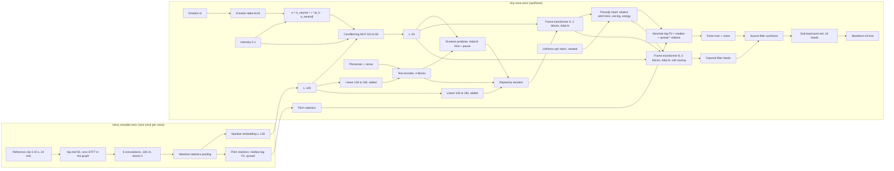

# Emotion control and one-shot voice cloning: analysis

Status: analysis only. Nothing was trained, downloaded or run on a GPU for this
report. Date: 2026-11-16.

Every number has a tag:

- **[M]** measured for this report, or taken from a measurement already
  recorded in this repository (the source is named);
- **[E]** an estimate, with the reasoning given;
- **[P]** a published figure (model card or paper) that was not checked here;
- **[V]** checked on the primary source (dataset page, licence file or model
  card) on 2026-11-16, without downloading anything. Anything still unconfirmed
  says UNVERIFIED.

Parameter counts come from instantiating prototype modules on CPU
(`scratchpad/proto.py`, see [Appendix A](#appendix-a-how-the-numbers-were-measured)).
Timings come from an AMD Ryzen 5 3600XT (6 cores / 12 threads, WSL2), PyTorch
2.11 and ONNX Runtime 1.32 (native CPU, not WASM). The existing test suite
passes on CPU (70 tests, 2 skipped) **[M]**.

---

## 1. Executive summary

**Recommendation: build "B-min".** Its synthesis graph has **4,989,465
parameters [M]**, so it stays under the 5,000,000 limit that `train.py`
enforces. The reference encoder is a separate graph with **377,472 parameters
[M]** that runs once per voice. Total: **5,366,937 [M]**.

B-min is option B with four changes. Each one is backed by a measurement or by
a problem in the current code:

1. **Sub-band post-net, not a waveform-rate one.** The planned ~170k waveform
   post-net costs **8.3 GFLOP per second of audio [M]**. The whole current model
   costs **0.90 GFLOP/s [M]**, so the post-net alone would be 9× the model. It
   would push the ONNX CPU real-time factor (RTF) from **0.019 to about 0.13 [M]**
   on one thread. The same idea run on 16 polyphase bands (1.5 kHz frame rate)
   has 133,584 parameters, costs **0.40 GFLOP/s** and adds **RTF 0.005 [M]**.
2. **AdaLN only where conditioning matters.** B-min puts AdaLN on the duration
   predictor and on the first norm of every block in frame transformers A and B.
   It does not put AdaLN in the text encoder; the encoder keeps an additive
   speaker term, as it has now. Full AdaLN on every norm of all three stacks
   costs **582,400 parameters [M]**; B-min's placement costs **208,000 [M]**.
   Extending AdaLN is the first knob to turn if speaker similarity plateaus.
3. **Distil the reference encoder from a frozen speaker verifier. Do not train
   it only jointly with the TTS model.** A jointly trained encoder only sees the
   TTS training speakers. That is at most 2,456 (LibriTTS-R), or 81 in this
   Italian fork's corpus **[M]**. Speaker verifiers are trained on more than 6k
   speakers **[P]**. Distillation keeps the 0.38M-parameter encoder that can run
   in the browser and borrows the verifier's ability to generalise to new
   speakers. The verifier never ships.
4. **Intensity interpolates the emotion embedding instead of being an extra
   MLP input.** The planned data has discrete intensity levels. A scalar input
   would never be calibrated against them; interpolation is calibrated by
   construction.

Your parameter estimates are confirmed: **A 4,743,818**, **B 5,966,730**, **C
9,590,577 [M]** (B and C include a kernel-5 reference encoder of 561,792).

Option C (256 channels) adds **49% more FLOPs [M]** (1.33 vs 0.89 GFLOP/s) and
**14 MB to the fp32 ONNX file [M]** (35.0 vs 21.3). Build it only if stage 2 shows
the model is capacity-bound: training loss still falling while similarity on
unseen speakers has flattened.

Problems in the current code that any option has to fix (details in §5–§8):

- `--init-from` refuses **any** configuration change (`train.py` `compatible()`
  compares the whole config). `load_compatible`'s tensor-growing path is
  therefore unreachable from the command line, and a format bump would also
  block branching from format-4 checkpoints.
- The voiced-vowel override (inference, export and the dataset targets) forces
  vowels voiced. That destroys whispering. The annotation gate
  `min_vowel_voiced` would also reject every whispered clip.
- The generator peak-normalises every clip to 0.95. That erases the loudness
  difference between soft and angry speech, which is exactly the energy cue that
  emotion needs.
- Preloading features takes about 6 GB for 11.4 h of audio **[M]**
  (`docs/italian.md`). LibriTTS-R would need roughly 300 GB of RAM **[E]**, so
  multi-speaker training must load features lazily.
- Dynamic int8 quantisation changed the output length by **1.2% [M]**: the
  rounding of predicted durations is sensitive to it. The duration and prosody
  heads must stay in fp32.

Estimated cost of B-min on one RTX 4090: about **56 GPU-hours [E]**, or
$25–45 at $0.45–0.80/h **[E]**. About 60 hours of CPU pitch tracking come on top
**[E]**. Option C: about **75 GPU-hours [E]**.

---

## 2. Parameters, size and speed

### 2.1 Parameter table

Counted by instantiating the modules on CPU, using the English configuration
(76 symbols, voices F2 and M2). Rows are grouped as in `docs/model.md`; the
"current" column reproduces that table exactly **[M]**.

| Component | Current | A | B | **B-min** | C |
|---|---:|---:|---:|---:|---:|
| Embeddings (phoneme, stress, voice, frame position) | 16,704 | 16,704 | 16,704 | 15,936 ¹ | 22,272 |
| Text encoder | 1,588,864 | 1,588,864 | 1,788,544 | 1,588,864 | 3,083,092 |
| Duration and pause predictor | 123,906 | 132,033 | 165,313 | 165,313 | 189,889 |
| Frame transformer A, prosody head | 795,971 | 820,482 | 920,322 | 870,402 | 1,576,236 |
| Frame transformer B | 1,985,984 | 1,985,984 | 2,235,584 | 2,110,784 | 3,853,737 |
| Source-filter waveform head | 25,862 | 25,862 | 25,862 | 25,862 | 34,438 |
| Waveform post-net | – | 173,889 ² | 173,889 ² | 133,584 ³ | 173,889 ² |
| Conditioning (emotion table, MLP, speaker projections) | – | – | 78,720 | 78,720 | 95,232 |
| *of which AdaLN modulation (inside the rows above)* | – | – | *582,400* | *208,000* | *765,440* |
| **Synthesis graph** | **4,537,291** | **4,743,818** | **5,404,938** | **4,989,465** | **9,028,785** |
| Reference encoder (separate graph) | – | – | 561,792 ⁴ | 377,472 ⁵ | 561,792 ⁴ |
| **Total** | **4,537,291** | **4,743,818** | **5,966,730** | **5,366,937** | **9,590,577** |
| Your estimate | 4.54M | ~4.74M | ~5.98M | – | ~9.6M |

¹ The voice tables are dropped. Named voices become cached 128-d embeddings.
² Waveform rate: 1→64 channels, 7 dilated residual blocks with kernel 5, 64→1.
³ Sub-band: 16 polyphase bands, 64 channels, 6 dilated blocks with kernel 5.
⁴ log-mel 80 → 6 convolutions of 128 channels, kernel 5 → attentive statistics
pooling → 128.
⁵ The same with kernel 3.

What the options contain:

- **A**: 64 duration bins on top of the existing duration and pause outputs; 128
  pitch bins on top of the existing pitch, voicing and energy outputs; the
  waveform post-net.
- **B**: A, plus AdaLN on both norms of every block in all three stacks and on
  the duration predictor, plus the conditioning MLP (161→128→64), a 6×32 emotion
  table and the 128→192 speaker projections. It keeps the old voice tables.
- **B-min**: AdaLN on `norm1` of each frame-stack block and on both duration
  predictor norms; the sub-band post-net; no voice tables.
- **C**: B with `channels=256, feedforward=853`.

Modules used only in training (not exported):

| Module | Parameters | Tag |
|---|---:|---|
| Auxiliary mel head (now) | 15,440 | M |
| Waveform discriminators (now) | 2,675,312 | M |
| Speaker classifier, AAM-softmax over 2,456 speakers × 128 | 314,368 | E (128×2,456) |
| Emotion adversary with gradient reversal (128→64→6) | 8,646 | E |
| Distillation projection (128 → teacher dimension 192) | 24,768 | E |
| Frozen teacher speaker verifier | 7–95M | P (see §4) |

### 2.2 ONNX file sizes

The fp16 file is a full weight conversion that keeps fp32 inputs and outputs.
The int8 file uses `quantize_dynamic` on MatMul and Gemm nodes.

| Graph | fp32 | fp16 | int8 | Tag |
|---|---:|---:|---:|---|
| Current architecture (IT1 weights) | 21.38 MB | 11.04 MB | 8.54 MB | M |
| 192 channels (random weights, same graph) | 21.34 MB | 11.03 MB | 8.51 MB | M |
| 256 channels (option C without conditioning/post-net) | 34.99 MB | 17.85 MB | 12.04 MB | M |
| B-min synthesis graph | ~23.2 MB | ~11.9 MB | ~9.0 MB | E: +452,174 params at 4/2/1 bytes |
| Option C synthesis graph | ~39.3 MB | ~20.0 MB | ~13.1 MB | E: 256-channel graph + 1,075,327 added params |
| Reference encoder, kernel 3 / kernel 5 | 1.51 / 2.25 MB | ~0.8 / 1.1 MB | – | M (fp32) / E |

About 3.2 MB of the current fp32 file is fixed STFT and cepstrum kernels, not
weights **[M]** (21.38 MB − 4,537,291 × 4 bytes).

### 2.3 CPU speed

The test sentence is Italian, 103 tokens, 568 frames, **6.06 s** of audio
**[M]**. RTF is compute time divided by audio duration; lower is faster. Each
time is the best of 5 runs after a warm-up.

| Configuration | 1 thread | 4 threads | Tag |
|---|---:|---:|---|
| Current model, PyTorch `synthesize` | 0.0207 | 0.0145 | M |
| Current model, ONNX fp32 | 0.0185 | 0.0119 | M |
| Current model, ONNX int8 | 0.0197 | 0.0132 | M (no speed-up on x86) |
| 256-channel graph, ONNX fp32 (7 frames per token) | 0.0264 | 0.0181 | M |
| 192-channel graph, same setup, for comparison | 0.0213 | 0.0137 | M |
| Waveform post-net alone, ONNX | **0.1094** | 0.0467 | M |
| Sub-band post-net alone, ONNX | 0.0046 | 0.0014 | M |
| Reference encoder (k3) on a 10 s clip | 6.1 ms per voice | – | M |
| **B-min, ONNX fp32** | **~0.023** | **~0.013** | E: current + sub-band post-net; AdaLN costs only per-utterance work |
| A or B with the waveform post-net | ~0.128 | ~0.059 | E: current + waveform post-net |
| Option C (256 channels, waveform post-net) | ~0.136 | ~0.065 | E |
| Option C with the sub-band post-net | ~0.031 | ~0.020 | E |

FLOPs per second of audio, from `torch.utils.flop_counter` on the ONNX
formulation (`Exportable`) **[M]**:

| Graph | GFLOP per audio second |
|---|---:|
| Current model (IT1) | 0.903 |
| 192-channel graph at 7 frames per token | 0.891 |
| 256-channel graph at 7 frames per token | 1.328 (×1.49) |
| Waveform post-net | 8.30 |
| Sub-band post-net | 0.40 |
| Reference encoder, k3, per 10 s clip (once per voice) | 0.64 |

ONNX Runtime Web with WASM on one thread is typically 2–4× slower than native
**[E]**. The current browser demo would then run at an RTF of about 0.04–0.07,
B-min at about 0.05–0.09, and the waveform post-net at about 0.3–0.5.

---

## 3. Architecture review: what I would keep and what I would change

### 3.1 Conditioning through AdaLN

- **Keep:** a 64-d conditioning vector `c` with zero-initialised modulation.
  Because `c` is constant within an utterance, the scale and shift are computed
  once per utterance. Inference cost is per-frame elementwise work only
  (measured as no change at the FLOP level).
- **Change the module layout so released weights still load.** Wrapping
  `norm1` in a new module renames `norm1.weight` to something like
  `norm1.norm.weight`. `load_compatible` would then report the old norms as
  `dropped` and reinitialise them silently. Instead, add a sibling
  `Block.modulation1 = Linear(64, 2C)` and leave `norm1` where it is. With zero
  initialisation, the branched model then computes exactly the same function as
  the released checkpoint until the modulation learns something. That is
  testable (§9, step 6).
- **Drop AdaLN from the text encoder (B-min).** The encoder turns phonemes into
  linguistic states. Speaker and emotion matter after expansion (spectrum,
  pitch) and in the duration predictor (rate, pauses), and both of those have
  AdaLN in B-min. The additive speaker term at token level stays, as a
  projection of `s`. That saves 199,680 parameters **[M]**.
- **One AdaLN per block, not two.** It saves another 174,720 **[M]**, and that
  is the margin that keeps the synthesis graph under 5M. In DiT-style models a
  single modulation point per block is usually enough. If the ablation in stage
  2 shows it is not, restore `modulation2` (+175k) and raise the budget on
  purpose (§9, step 5).
- **The duration and prosody predictors.** The pitch predictor is frame
  transformer A plus a linear head, so AdaLN in A already reaches it. The
  duration `Predictor` has two LayerNorms of width 128 and gets AdaLN on both
  (33,280 parameters **[M]**).

### 3.2 Emotion and intensity

- **Interpolate:** `e = e_neutral + i · (e_k − e_neutral)` and feed `e`, not a
  bare `i`, to the MLP. With discrete training levels such as {0.5, 1.0} (see
  §6), a separate `i` input has no data between the levels and nothing ties
  `i = 0` to neutral. With interpolation, `i = 0` is neutral by construction, the
  levels anchor the line, and values above 1 extrapolate if someone wants to
  exaggerate. `i` can still go to the MLP as well; that is cheap.
- **"Whispering/soft" is a phonation mode, not an emotion.** It changes voicing
  (none) and spectral tilt, and the source-filter head handles it natively: all
  frames unvoiced means only the noise branch sounds. It does, however, clash
  with three hard-coded rules (§7.3). Keep it as a seventh label (`whisper`)
  separate from `soft` (low energy, breathy but voiced), or drop it from the
  first release.

### 3.3 Reference encoder: joint training, external encoder, or distillation

| Approach | Ships in the browser | Generalises to unseen speakers | Licence risk | Verdict |
|---|---|---|---|---|
| Joint training only (your proposal) | 0.38–0.56M, 1.5–2.3 MB **[M]** | Bounded by the TTS speakers (≤2,456) | none | weak similarity on unseen voices **[E]** |
| Frozen external verifier as the speaker input | 7–95M, 28–380 MB fp32 **[P]** | good **[P]** | depends on the checkpoint | too big for the demo |
| **Distilled student (recommended)** | 0.38M, 1.5 MB **[M]** | between the two; closer to the teacher when distilled on audio from many speakers **[E]** | teacher used only in training | best trade-off |

Distillation recipe. The student is the reference encoder. Stage 2a: regress a
projection of the student's output onto the teacher's embedding (cosine loss)
on **audio only, no transcripts needed**: LibriTTS-R plus any large
multi-speaker corpus whose licence allows training. Stage 2b: fine-tune jointly
with the TTS loss, keeping the distillation loss as a regulariser. The student
learns the identity space from many more speakers than the TTS model ever
synthesises.

Candidate teachers. All teachers take 16 kHz input.

| Teacher | Parameters | Training data | Equal error rate, VoxCeleb1-O | Weights licence |
|---|---:|---|---:|---|
| **CAM++ (3D-Speaker)** | 7.2M **[V]** | VoxCeleb or CN-Celeb recipes (the 200k-speaker model is Mandarin) | ~0.7% **[P]** | Apache-2.0 **[V]** |
| WeSpeaker ResNet34 | ~6.6M (UNVERIFIED) | VoxCeleb | ~0.7–0.9% **[P]** | "follows the dataset licence": VoxCeleb, CC BY 4.0 **[V]** |
| **SpeechBrain ECAPA-TDNN** | ~20.8M (UNVERIFIED) | VoxCeleb1+2 | 0.80% **[V]** | Apache-2.0 **[V]** |
| WavLM-Base-Plus-SV | ~95M (UNVERIFIED) | 94k h pre-training, VoxCeleb1 fine-tuning | **[P]** | points to UniSpeech: **CC BY-SA 3.0** (share-alike) **[V]** |

Choice: **CAM++ as the training teacher** (small, Apache-2.0) and **ECAPA for
evaluation**. WavLM-SV is excluded because its share-alike terms could be
argued to reach a distilled student.

VoxCeleb is celebrity speech collected from YouTube. Training a teacher on it
is standard practice, but record it in the model card's provenance.

**Use one verifier for training and a different one for evaluation.** If the
speaker-consistency loss (§5.3) uses CAM++, report similarity with ECAPA.
Otherwise the metric measures how well the generator fools its own
teacher.

### 3.4 Pitch from the reference by DSP

- **Keep the normalisation.** Training targets become
  `(log F0 − μ_spk) / σ_spk`, with per-speaker statistics computed over all of
  that speaker's trusted voiced frames. The network then learns relative
  contours, which is also what makes an emotion's pitch pattern transfer between
  voices. The pitch bins (§5.1) live in this relative space.
- **Problems to handle:**
  1. **Noise in short references.** A 3 s clip has about 1.5 s of voiced frames
     (~140 frames) **[E]**. The median is then stable to roughly ±0.5 semitone,
     but the spread is noisy. Use the median plus a robust spread (MAD), and
     shrink the spread toward the training population mean for clips under 5 s.
  2. **Emotional references.** An angry or happy reference raises the median by
     several semitones **[E]**. In training, compute speaker statistics from
     neutral clips (or all clips for unlabelled corpora). At inference, the
     reference sets the baseline; document that a neutral reference gives the
     most controllable result.
  3. **The browser has no pyin.** Either port a YIN tracker to JS or, simpler and
     deterministic, give the reference encoder a 2-output head that regresses
     the DSP statistics (`PST` in the diagram). Train it against pyin, which
     costs 258 parameters, and keep pyin in the Python path. Named voices store
     their pyin statistics in `config.json`.
  4. **Whispered or creaky references** have few voiced frames. Fall back to the
     head's prediction, and warn the user.
- The existing `pitch_shift` and `pitch_range` controls map directly onto
  `μ` and `σ`, so they keep working.

### 3.5 Speaker and emotion leakage

- **References from different clips: yes.** Pick them from other texts of the
  same speaker, never the same text (to avoid leaking content), and from another
  session or chapter when the corpus records one (LibriTTS-R has chapters).
- **Different-emotion references** are only possible for voices that have
  emotion data, that is, the synthetic designed voices of §6. Use them for 50% of
  the samples from those voices.
- **The adversarial emotion classifier** (gradient reversal on `s`) can be
  trained only where emotion labels exist. It is small (≈8.6k parameters
  **[E]**) and cheap. Monitor its accuracy; it should end near chance (1/6).
- **The speaker-classification auxiliary loss** (AAM-softmax on `s`) is useful
  while the distillation loss is still weak, and redundant with it later. Keep
  its weight low (0.1 **[E]**).

---

## 4. The planned quality items, checked against the code

| Item | Verdict | Notes |
|---|---|---|
| Pitch as classification over bins with temperature | **Keep, with sampling per token** | See below. 128 bins × 0.375 semitone in the speaker-relative space (−18 to +30 st; emotion pushes upwards). Keep the regression output as row 0 so `load_compatible` can grow the head (§8.2). |
| Durations as classification over bins | **Keep** | 64 log-spaced bins over 1–400 frames, plus the existing pause logit. Sample once per token. |
| Temperature sampling | **Change: never sample each frame independently** | Independent per-frame samples produce jitter, not intonation. Draw one uniform `u` per token and take each frame's tempered-CDF quantile at that token's `u`. Contours stay coherent and the result is deterministic given `u`. For ONNX parity and the determinism tests, `u` is a graph **input** (seeded in Python and in JS), not `RandomUniform`. |
| EMA weights | **Keep** | Training-only shadow copy; export the EMA weights. The snapshot grows by one copy of the model (~18 MB). |
| Cosine LR to ~0 | **Keep** | It replaces the half-life schedule; `learning_rate()` gets a `schedule` field in the recipe, so old recipes still resume. |
| Soft voicing for the decoder | **Keep, with a data caveat** | `prepare.py` throws away pyin's voiced probability (`f0, voiced, _ = librosa.pyin(...)`), so teacher forcing can only give hard 0/1 while inference gives `sigmoid(logit)`, a mismatch. Either store the probability (feature version 3, which means re-running feature preparation) or teacher-force a time-smoothed 0/1. |
| Waveform post-net ~170k | **Replace with the sub-band post-net** | 8.3 vs 0.40 GFLOP/s and RTF 0.109 vs 0.005 **[M]**. Both need explicit masking at utterance ends, otherwise `test_padding_does_not_change_the_short_example` fails, because the convolutions' receptive field crosses the end of an utterance into the padding. |

---

## 5. Loss changes

### 5.1 Prosody and duration

- `pitch`: cross-entropy over relative bins on trusted voiced frames, with
  Gaussian label smoothing (σ = 1 bin). Untrusted frames keep the current 0.1
  weight. Keep L1 on the expected value as an auxiliary term with weight 0.5
  **[E]**, so the regression row stays meaningful.
- `pitch_spread`: compute it on the expected value of the tempered distribution
  at temperature 1. Remove it if the bins already restore the range (the
  validation metric `pitch_spread_ratio` already exists).
- `duration`: cross-entropy over bins where `durations > 0`, plus the existing
  MSE on `log1p` as an auxiliary term. Track `duration_length_error`; summing
  sampled bins drifts more than regression does.
- Soft voicing: unchanged BCE; the decoder conditioning changes (§4).

### 5.2 Conditioning

| Term | Where | Weight **[E]** |
|---|---|---:|
| Distillation, cosine(student→proj, teacher) | reference encoder | 1.0 in stage 2a, 0.3 after |
| Speaker AAM-softmax on `s` | reference encoder | 0.1 |
| Emotion adversary (gradient reversal, λ ramped 0→0.5) | `s`, labelled clips only | 0.5 |
| Emotion auxiliary classifier on mean-pooled frame transformer A states | prosody stack | 0.2 |
| Pitch-statistics head, L1 to pyin statistics | reference encoder | 0.1 |

### 5.3 Speaker consistency

After the GAN starts, take the generated crops the critics already see. Compute
`1 − cos(T(fake), T(reference))` with the frozen teacher `T` and backpropagate
through the waveform. Balance it like the GAN term: its gradient at the
waveform should be a fixed ratio (0.2 **[E]**) of the reconstruction gradient,
reusing the `gan_scale` code. The teacher needs 16 kHz audio, so add a fixed
resampling convolution. **[E]** cost: −15% steps/s.

### 5.4 Stage 4 (adversarial-only, free-running) is limited

With predicted durations, the output no longer lines up with the recording.
The STFT and mel losses are then undefined, **and so is feature matching**,
which needs aligned real crops. Only the least-squares adversarial term against
unpaired real crops is left. With `--teacher-final 0` the decoder already sees
its own pitch, voicing and energy, so the only mismatch left is durations.

Recommendation: make stage 4 optional, short (≤10k steps), at a low learning
rate (≤3e-5), and keep it only if WER, UTMOS and similarity improve on
validation. A safer alternative: fine-tune only the decoder and post-net on
**predicted pitch with recorded durations**. That is the current
`teacher_final=0` regime plus the oscillator driven by predicted pitch, and the
target stays aligned except for the pitch itself.

---

## 6. Data plan

### 6.1 How many speakers and hours for zero-shot

Published experience points to a threshold. Jia et al. (2018, transfer from
speaker verification) found that a synthesizer trained on VCTK (109 speakers)
generalised poorly to unseen voices, while one trained on LibriSpeech (~1.2k
speakers) did much better. Their encoder was trained on ~18k speakers **[P]**.
At 5–10M parameters, capacity also limits similarity.

Estimates **[E]**:

| Tier | Speakers | Hours | Expected outcome |
|---|---:|---:|---|
| Pipeline pilot | ~250 (LibriTTS-R train-clean-100) | ~54 | the pipeline works; poor similarity on unseen voices |
| Minimum useful | ≥1,000 | ≥250 | recognisable timbre and pitch level; accent and rhythm only roughly |
| Target | ~2,400 (all of LibriTTS-R) | ~550 | best this model size can reach; diminishing returns beyond |

Candidate corpora. The licence decides: only data that allows releasing the
trained weights openly (CC BY, CC0, ODbL, Apache-2.0 output) goes into a
released model.

**Multi-speaker, English**

| Corpus | Licence | Hours | Speakers | Rate | Verdict |
|---|---|---:|---:|---|---|
| **LibriTTS-R** | CC BY 4.0 **[V]** | ~585 **[V]** | ~2,456 (UNVERIFIED; the page gives no count) | 24 kHz **[V]** | **main TTS corpus**: clean, native rate |
| **GLOBE** | CC0 **[V]** | 535 **[V]** | **23,519** (164 accents) **[V]** | 24 kHz **[V]** | **speaker diversity**: Common Voice audio filtered and enhanced. Screen it with DNSMOS/UTMOS, because enhancement leaves artefacts **[E]** |
| VCTK 0.92 | CC BY 4.0 (UNVERIFIED: the licence file was not shown) | ~44 (UNVERIFIED) | 110 (p315 has no text) **[V]** | 48 kHz | accent variety and parallel sentences for evaluation; resample before `prepare` |
| Hi-Fi TTS | CC BY 4.0 **[V]** | 291.6 **[V]** | 10 **[V]** | 44.1 kHz | too few speakers for cloning |
| MLS English | CC BY 4.0 **[V]** | 44,660 **[V]** | 5,490 **[V]** | **16 kHz** | caps the bandwidth; distillation audio at most |
| Emilia (101.7k h) | **CC BY-NC 4.0 [V]** | | | | **excluded**: non-commercial |
| Emilia-YODAS | CC BY 4.0 **[V]** | 113.9k **[V]** | not stated | not stated | possible later; no Italian; the repository tag mislabels the NC part |

**Multi-speaker, Italian**

| Corpus | Licence | Hours | Speakers | Rate | Verdict |
|---|---|---:|---:|---|---|
| **CML-TTS Italian** (local copy) | CC BY 4.0 **[V]** | **145.2 [M]** (~131 train **[V]**) | **81 [M]** (61 train, 10 dev, 10 test, disjoint **[M]**); 22 have ≥1 h, 43 have ≥0.5 h **[M]** | 24 kHz | **Italian TTS corpus**, and the unseen-speaker test set (10 + 10 speakers). Too few speakers for real zero-shot on its own |
| Common Voice Italian v24 | CC0 **[V]** | 362 validated **[V]** | **7,319 [V]** | MP3, mixed microphones | **reference-encoder distillation only** (no TTS targets). Now distributed through Mozilla Data Collective, which needs an account (the same obstacle `docs/italian.md` hit) |
| MLS Italian | CC BY 4.0 **[V]** | 247.4 train **[V]** | 65 train **[V]** | **16 kHz** | the same LibriVox family as CML-TTS at a lower rate; skip |
| VoxPopuli Italian | CC0 plus the EU Parliament notice **[V]** | 91 **[V]** | 306 **[V]** | 16 kHz | reverberant parliament speech; skip |

No other Italian corpus with many speakers at ≥22 kHz was found **[V]**. There
is no Italian counterpart of GLOBE; building one (enhancing Common Voice
Italian) is a project of its own.

**Emotion** (real corpora, for comparison with the synthetic route of §6.2)

| Corpus | Licence | Size | Labels and intensity | Whisper | Verdict |
|---|---|---|---|---|---|
| ESD | **research-only**, licence form **[V]** | 10 en + 10 zh speakers, 350 parallel sentences | 5 emotions; no intensity | no | excluded from released weights |
| Expresso (Meta) | **CC BY-NC 4.0 [V]** | ~40–46 h, 4 speakers | 8 read styles, 26 improvised | **yes, ~2.8 h** | excluded; the only whisper source |
| EmoV-DB | **non-commercial [V]** | 4 speakers | 5 styles | no | excluded |
| RAVDESS | **CC BY-NC-SA 4.0 [V]**; a paid commercial licence exists | 24 actors, 2 sentences | 7 + neutral; normal/strong | no | excluded |
| MSP-Podcast v2 | academic licence; commercial terms not described **[V]** | 409 h, ~3.9k speakers | 8 categories + dimensions | no | excluded unless licensed |
| **CREMA-D** | **ODbL / DbCL, commercial use with attribution [V]** | 91 actors, 12 sentences | 6 emotions; low/medium/high intensity | no | **real-data anchor and evaluation, English**; low-fi audio and few sentences, so not a TTS target |
| **Emozionalmente** (Italian) | **CC BY 4.0** on OpenSLR 161 **[V]** (the CAMEO re-packaging says NC-SA: use the OpenSLR copy) | 6,902 clips, 431 actors | 7 incl. neutral; no intensity | no | **real-data anchor and evaluation, Italian**; 16 kHz |
| EMOVO (Italian) | UNVERIFIED ("research purposes" on a mirror) | 6 actors, 14 sentences | 7 | no | excluded until clarified |

Every real corpus with whisper or more than two intensity levels is
non-commercial or research-only, except CREMA-D (three levels, but 12 sentences
of low-fi audio). That confirms the synthetic route for training data.

### 6.1a Chosen datasets

| Use | English | Italian |
|---|---|---|
| Multi-speaker TTS (stage 2b) | **LibriTTS-R**; GLOBE after a quality screen as a second step | **CML-TTS** (61 train speakers) |
| Reference-encoder distillation (stage 2a, audio only) | LibriTTS-R + **GLOBE** (~26k speakers together) | CML-TTS + **Common Voice IT** (needs the Data Collective account); the encoder can also be shared across languages, since timbre is language-independent **[E]** |
| Emotion training data (stage 3) | **Qwen3-TTS synthetic** (§6.2) | **Qwen3-TTS synthetic**; all variants list Italian **[V]**, but Italian emotional quality is untested |
| Emotion evaluation anchors | CREMA-D | Emozionalmente (OpenSLR copy) |
| Unseen-speaker evaluation | LibriTTS-R test-clean | CML-TTS test speakers (10) |
| Teachers (training only) | CAM++ (training), ECAPA (evaluation) | same |

What this means for the Italian fork **[E]**: with 61 training speakers,
Italian zero-shot will be weaker than English. The realistic order is: build
and validate the pipeline in English on LibriTTS-R, then train Italian with an
encoder distilled on Common Voice IT plus CML-TTS, and keep the existing
fine-tune adaptation (§9.3) as the high-quality Italian path.

Practical consequences, measured or derived:

- **Feature preparation:** pyin took 4 min 10 s for 0.65 h with 11 workers
  **[M]** (`docs/italian.md`), about 6.4 min per audio hour. 585 h therefore
  needs about **62 h** of wall time on this 12-thread machine **[E]**. Rent a
  machine with 64 or more cores for this step, or switch the pitch tracker. A
  switch changes `acoustic_config`, which means feature version 3 and a full
  re-run, so decide it together with the voiced-probability change (§4).
- **Disk:** the feature files store float32 waveforms (96 kB/s) plus mel, about
  **220 GB** for 585 h **[E]**.
- **RAM:** preloading would need about **300 GB [E]** (6 GB per 11.4 h
  **[M]**). Use `--no-preload`, the existing lazy path, from NVMe.
- **Annotation (wav2vec2):** 4.5 min for 12.7 h on the RTX 5070 Ti **[M]**, so
  about 3.5 GPU-hours for 585 h **[E]**.

### 6.2 Emotion data from Qwen3-TTS

The current generator (`scripts/generate_audio.py`) uses only the **Base**
cloning model with two VoiceDesign references and `x_vector_only_mode=False`.
Base reproduces the *style of the reference clip* along with the timbre. That
gives a controllable route that needs no instruction support in Base.

1. **Emotional reference clips.** For each designed voice and each emotion and
   intensity level, use the **VoiceDesign** model with that voice's existing
   description plus a style clause ("speaking angrily, raised voice",
   "whispering", ...). Generate 5 candidate references and keep the one closest
   in speaker similarity to the neutral reference.
2. **Bulk generation.** Clone each emotional reference with Base on the normal
   script pool, exactly like the first batch (`generate_voice_clone` with
   `voice_clone_prompt`).
3. **Speaker variety.** Design 20 additional voices (10 F, 10 M) to break the
   link between emotion and the two house voices **[E: enough to stop the
   emotion embedding from encoding timbre]**.

What the Qwen3-TTS variants can do **[V]**:

- **VoiceDesign 1.7B** takes a natural-language description of voice, emotion
  and prosody, but does not clone.
- **CustomVoice 1.7B** takes instructions ("angry", ...) but only for its 9
  preset voices. The 0.6B CustomVoice lists no instruction control.
- **Base 1.7B and 0.6B** clone from 3 s of audio but take no instructions.

No single variant clones a voice *and* follows emotion instructions, which is
why the route above goes through emotional references. All variants list 10
languages including Italian. The weights are Apache-2.0; the generated audio
has no stated terms (Apache-2.0 does not restrict outputs, but there is no
explicit grant), so the model card should say the data is synthetic and how it
was made. CustomVoice stays as the pilot's second arm (preset voices only).

**Intensity:** generate two levels per emotion (style clauses "slightly ..." and
"very ...", labelled 0.5 and 1.0) plus neutral at 0. After generation, re-label
using the emotion classifier's posterior, rank-normalised per voice and
emotion. That makes the labels about the audio, not about the prompt.

**Remove per-clip peak normalisation for emotion data.** Store the gain applied
(or none) in the row, and normalise loudness per *voice* instead. Otherwise
whispered and angry clips end up at the same peak and the energy target loses
the cue.

Volume **[E]**: 22 voices × 6 emotions × 2 levels × ~40 clips ≈ 10.5k clips,
about 11 h. At the throughput of the first batch, generation and Whisper
screening take about 4–6 GPU-hours.

### 6.3 The 50-clip pilot

Design: voices F2 and M2 × 5 non-neutral emotions (happy, sad, angry,
surprised, whisper) × 5 sentences = **50 clips**, all at intensity 1.0, through
route 1+2. Five of the sentences are emotion-neutral in wording (for example
"The meeting moved to Thursday at three"), so the label cannot come from the
text.

Acceptance test. All gates must hold for at least 4 of the 5 emotions; the
thresholds are **[E]**:

| Check | Tool | Gate |
|---|---|---|
| Intelligibility | Whisper small.en, the existing normaliser | WER ≤ 15% (≤ 25% for whisper) |
| Emotion recognisable | an emotion classifier: emotion2vec+ large (FunASR Model Licence v1.1, attribution required, commercial use not addressed **[V]**: evaluation only, not part of a release pipeline) | top-1 = intended label on ≥ 7 of 10 clips; whisper is judged by voiced-frame fraction < 20% instead (classifiers have no whisper class) |
| Identity kept | external verifier, cosine to the voice's neutral reference | ≥ 0.6 and ≥ 0.8 × the neutral-to-neutral cosine |
| Annotation | `tiny_voca.annotate` with the §7.3 changes | ≥ 90% accepted; record median token probability per emotion |
| Pitch tracker sanity | pyin octave-jump rate (`trusted` fraction) | ≥ 85% trusted voiced frames per clip (angry and surprised are the risk) |
| Loudness spread | RMS in dB per emotion | whisper and soft at least 6 dB below angry |
| Listening | 2 listeners, blind, 5-way choice | ≥ 70% agreement with the label |

Cost **[E]**: under 0.5 GPU-hours plus one hour of listening.

### 6.4 Effects on the annotation pipeline

| Area | Effect | Change |
|---|---|---|
| Speaker set | `prepare.py` and `AnnotatedDataset` reject any speaker not in `Config.speakers`, and that tuple goes into the config fingerprint | Add an open-set `speaker_id` field in rows. `Config.speakers` becomes the list of *named* (cached) voices only. Add `Config.speaker_conditioning = "table" | "embedding"`. |
| wav2vec2 alignment | trained on read Common Voice; whispered input has no voicing and weaker formants **[E]** | Record `token_probability_mean` per emotion in the pilot. If whisper falls below the 0.5 gate, align the whispered clip's *text* against a neutral rendition of the same sentence and voice, transferred by DTW on mel. Same text, same generator, so the phone sequence is identical. |
| Timing probe and onset offset | calibrated on voicing flips, which do not exist in whisper | exclude whisper from the probe and keep the −19 ms offset |
| pyin on angry or surprised speech | harsh phonation causes octave errors; surprised speech has legitimate leaps above 0.65 octave that `continuous_pitch(tolerance=0.45)` marks untrusted | per-emotion tolerance (0.7 for surprised) and a log of the trusted fraction per emotion. `f0_max = 600` is enough **[E]**, and the `hard_prosody` clamp allows 27–896 Hz |
| Voiced-vowel targets (`data.py`) | marks vowel frames voiced, so whisper would be trained as voiced | skip when `emotion == "whisper"` |
| Gate `min_vowel_voiced = 0.5` | rejects every whispered clip | exempt whisper; require voiced-frame fraction < 0.2 instead |
| New manifest fields | – | `speaker_id`, `corpus`, `emotion` (enum), `intensity` (float), `intensity_source` (prompt or classifier), `style_reference` (generator prompt id), `reference_ids` (≤ 8 same-speaker, other-text clip ids from the same split), `gain_db`; per-speaker `pitch_stats {median, mad, frames}` in `summary.json` |
| Versions | – | `ANNOTATION_VERSION` 3 → 4 (fields, gate, per-speaker statistics). `CHECKPOINT_FORMAT` 4 → 5 (conditioning, head layout, EMA). Feature version 2 → 3 only if voiced probability is stored or the pitch tracker changes. |

---

## 7. Training plan

### 7.1 Stages

| Stage | Starts from | Data | Steps **[E]** | B-min, 4090 h **[E]** | C, 4090 h **[E]** |
|---|---|---|---:|---:|---:|
| 1. Quality items (option A, with the sub-band post-net) | released checkpoint, `--init-from` (after step 5 of §9) | current data | 40k | 3.5 | – (C cannot reuse it) |
| 2a. Distil the reference encoder | random | audio only (LibriTTS-R + Common Voice) | 100k small steps | 2 | 2 |
| 2b. Multi-speaker TTS + conditioning | stage 1 + the stage 2a encoder | LibriTTS-R (+ F2/M2 as cached voices) | 400k | 43 | 58 |
| 3. Emotion | stage 2b | emotion set + 50% replay of stage-2 data | 60k | 6.5 | 9 |
| 4. Free-running (optional, §5.4) | stage 3 | all | ≤10k | 1 | 1.5 |
| **Total** | | | | **≈56** | **≈75 (from scratch)** |

How the hours were estimated. The released English model ran **104,737 steps
in 7.7 h** on a 4090, 3.8 steps/s on average **[M]** (`docs/model.md`). The RTX
5070 Ti measured 9.7–10.2 steps/s before the GAN and 4.3–4.5 with it **[M]**
(`docs/italian.md`). For B-min I assume −30% steps/s from the post-net, the
reference-encoder pass and the teacher's speaker-consistency forward and
backward pass, giving ~2.6 steps/s with the GAN on **[E]**. For C, a further
−25% (FLOPs ×1.49 in the generator; the critics are unchanged) **[E]**.

Why 400k steps: a batch of 9,000 frames holds about 96 s of audio, so 400k steps
see about 10.7k h, about 18 epochs of LibriTTS-R **[E]**.

Cost **[E]**: rented 4090s at $0.45–0.80/h. B-min ≈ $25–45; C ≈ $35–60. Add
data generation (~5 GPU-hours), annotation (~3.5) and CPU pitch tracking
(~60 h on 12 threads; less on a rented many-core machine).

### 7.2 What can branch from the released checkpoint

Simulated with the prototypes and the semantics of `load_compatible`:

| Tensor | Stage 1 (A) | Stage 2 (B-min) | Option C |
|---|---|---|---|
| `duration.out` 2→66 rows (bins appended after the regression and pause rows) | **grown**, old rows kept | – | grown, but not function-preserving |
| `prosody_head` 3→131 rows (pitch, voicing, energy, then bins) | **grown** | – | grown, but not function-preserving |
| `postnet.*` | **new** (zero-initialised output = identity) | – | new |
| `*.modulation1`, `duration.modulation*` | – | **new**, zero-initialised: same function | new |
| `conditioning.*`, `speaker_in`, `speaker_frames`, `reference_encoder.*` | – | **new** | new |
| `voices.weight`, `frame_voices.weight` | kept | **dropped** (F2/M2 become cached 128-d embeddings, fitted in stage 2b by enrolling their reference clips and fine-tuning those two vectors) | dropped |
| Every 192-wide tensor | copied | copied | **grown 192→256**. LayerNorm statistics over 256 channels include the new random channels, so the function is *not* preserved. In practice C is trained from scratch. |
| Optimizer state | reset (tensors grew) | reset | reset |
| Critics | kept (the released checkpoint is past `gan_start`) | kept | kept |

Two blockers in the current `train.py`:

1. `compatible()` raises if `state["config"] != c.to_dict()`, for `--init-from`
   as well. No configuration change can branch, so the grow path in
   `load_compatible` is reachable only from tests. Fix: an allow-list of
   architecture-only fields (`speaker_conditioning`, `pitch_bins`,
   `duration_bins`, `postnet`, `adaln`, `channels`, `feedforward`) that may
   differ when branching. DSP, vocabulary and language must still match.
2. `CHECKPOINT_FORMAT` must equal the code's. Format 5 has to accept a format-4
   source in `--init-from` (not in `--resume`) and record the migration in
   `branched_from`.

The parameter guard `count > 5_000_000` should become `Config.max_parameters`
(default 5,000,000) so that raising it is a recorded decision. B-min does not
need it raised.

---

## 8. Export and web

### 8.1 Graphs

**`voice_encoder.onnx`** (new).

- Input: `audio float32 [1, S]` at 24 kHz. The browser resamples microphone or
  file input with an `OfflineAudioContext`.
- In the graph: the conv-STFT already used in `export.py` (`_analysis_kernels`),
  a constant mel matrix, log, the encoder, and the pitch-statistics head.
- Outputs: `speaker [1,128]`, `pitch_stats [1,2]`.
- Size: 1.5 MB fp32 **[M]**. Runs once per voice, ~6 ms per 10 s clip on one
  native thread **[M]**.
- Parity test: Python mel vs graph mel, Python embedding vs ONNX embedding,
  with a cosine ≥ 0.999 gate.

**`tiny-voca.onnx`** (changed).

- New inputs: `speaker float32 [1,128]`, `pitch_stats float32 [1,2]`,
  `emotion int64 [1]`, `intensity float32 [1]`, `temperature float32 [1]`,
  `uniforms float32 [1, N]` (one per token, seeded).
- Removed input: `voice int64`.
- Kept: `speed`, `pitch_shift`, `pitch_range`.
- In the graph: the post-net. The voiced-vowel override becomes conditional:
  `override = vowel & (emotion != whisper)`.
- `metadata()` writes `voices: {"F2": {"speaker": [128 floats], "pitch_stats":
  [μ, σ]}, ...}` and `emotions: [...]`. It keeps `inputs` and `outputs` so the
  worker can detect the old interface.

### 8.2 int8 plan

Measured **[M]**: 21.4 → 8.5 MB, no speed gain from native x86 ONNX Runtime, and
an output length that changed by 1.2%: a few rounded durations flipped.

Plan:

- Quantise only the MatMul and Gemm nodes inside the three transformer stacks.
  Pass `nodes_to_exclude` for the duration predictor, the prosody head, the
  conditioning MLP, the AdaLN modulation and the vocoder heads.
- Run `preprocess` (shape inference) first.
- Gate the result in `scripts/check_onnx.py`: identical durations on the
  evaluation sentences, mel L1 within 2% of fp32, and Whisper WER unchanged.
- Ship int8 only if WASM timing shows a speed-up; otherwise ship fp16 weights
  (11–12 MB) to save download size alone.

### 8.3 Changes to `worker.js`

- New message `{type: "enrol", audio, sampleRate, consent: true}`. It refuses
  without `consent`, runs the encoder, and returns `{speaker, pitchStats}`. The
  page keeps the vector in IndexedDB on the user's machine only; nothing is
  uploaded.
- `speak` takes `voice` as `{name}` (a cached voice from the config) or
  `{speaker, pitchStats}` (an enrolled one), plus `emotion`, `intensity`,
  `temperature` and `seed`.
- `uniforms`: a seeded PRNG in JS (for example mulberry32), so a given seed
  replays the same audio in the browser and in Python (parity test with the same
  uniforms).
- Bump `VERSION` so cached assets are replaced, and detect an old `model.onnx`
  by its `inputs` list.

---

## 9. Evaluation plan

### 9.1 Fixed set (versioned, kept in the repository)

- 300 sentences: 100 held-out validation-style sentences, 80 new LLM-written
  sentences, 50 number, date, money and time templates (rendered with a fixed
  seed), 40 questions and exclamations, and 30 emotion-neutral sentences for
  emotion tests.
- **Unseen speakers:** 40 from LibriTTS-R test-clean (English). For the Italian
  fork, the 10 CML-TTS test speakers **[M: disjoint from train]**. Each speaker
  gets two references (3 s and 10 s) taken from texts not in the 300.
- **Seen speakers:** F2, M2 (and IT1, IT2 for the Italian fork).

### 9.2 Metrics

| Metric | Tool | Notes |
|---|---|---|
| WER and CER | faster-whisper small.en / small (it) | the existing `evaluate.py` path |
| Template CER | same | only on the 50 templates; the number and date reading is the known weak spot |
| UTMOS, DNSMOS | UTMOS22 strong, DNSMOS P.835 (check both licences) | naturalness proxies; report the recordings' scores alongside |
| Speaker similarity | **an external verifier that is not the training teacher** | cosine to a *different* clip of the target speaker. Report it against a floor (cross-speaker cosine) and a ceiling (same speaker, real vs real), as `(sim − floor)/(ceiling − floor)` |
| F0 RMSE in cents | pyin, voiced frames, synthesis with recorded durations | absolute (level) and mean-removed (contour) |
| MCD | mel-cepstral distortion with DTW | the existing `dtw_distance` is a mel-L1 relative of it |
| Emotion accuracy per intensity | emotion classifier at i = 0.25, 0.5, 0.75, 1.0 | must increase monotonically; also measured on *unseen speakers* (tests independence of emotion and speaker) |
| Leakage checks | neutral-to-emotion speaker similarity; emotion classifier on neutral output from emotional references | similarity drop ≤ 0.05; neutral stays ≥ 80% "neutral" |
| CPU RTF | ONNX Runtime 1 and 4 threads, plus WASM in the browser | §2.3 is the baseline |

### 9.3 Baseline (current checkpoints)

Already measured in this repository **[M]**:

- English release, WER (Whisper small.en, 8–16 clips): validation 0.6%, test
  0.9%, new sentences 0.0%.
- Italian IT1 at 90k: test WER 7.1% (recordings 9.1%), CER 1.6%, challenge
  sentences 4.5%, mean pitch 149 Hz (recordings 148 Hz).
- IT2 adaptation as a stand-in for "cloning" by fine-tuning: acoustic mode,
  28 min of data and 23 min of training. Mean pitch 100 Hz against 107 Hz for
  the recordings, and the IT2 test WER is 13.0%.
- CPU RTF: §2.3.

Not yet measured: UTMOS, speaker similarity, F0 RMSE, MCD, template CER.
These need external models that this analysis was not allowed to download.
They are step 1 of §10. The IT2 adaptation result is the bar for zero-shot:
**zero-shot on IT2's clips should reach a similarity that is at least a useful
fraction of what 23 minutes of fine-tuning gives**.

---

## 10. Risks and alternatives

| Risk | Likelihood **[E]** | Mitigation |
|---|---|---|
| Speaker and emotion entangle (emotion seen only on designed voices) | high | 22 designed voices; gradient reversal; emotion acting mainly through relative prosody; emotion-on-unseen-speaker metric as a gate |
| Quality drops for F2 and M2 (and IT1) | medium | keep them as cached voices, give them a 10% sampling share in stages 2 and 3, and set a gate: WER and UTMOS no worse than the baseline + 0.5 points |
| Weak similarity on unseen speakers at 5M parameters | high | distillation; then full AdaLN (+374k); then C; accept "recognisable" instead of "identical"; fine-tune adaptation (already in the repository) stays the high-quality path |
| Synthetic emotion data sounds acted or uniform | medium | the classifier-based intensity re-labelling and listening gates of the pilot |
| Whisper breaks alignment and gates | medium | §6.4; drop whisper from the first release if the pilot fails |
| Licences | medium | train only on CC BY 4.0 / CC0 audio plus Apache-2.0 generator output; keep research-only emotion corpora out of released weights; record the teacher's provenance in the model card |
| LibriVox readers never consented to being cloned | – | do not ship LibriTTS-R speaker embeddings as named voices or demo presets; use them for training only |
| Misuse (cloning real people without consent) | – | see below |

Safeguards to ship with the cloning feature:

- **Model card:** a consent statement ("only clone voices whose owners have
  given explicit permission"), prohibited uses (impersonation, fraud,
  harassment, political deception), and a statement of what the model cannot
  do (it does not verify identity or consent).
- **Demo:**
  - no celebrity or public-figure reference clips, and no upload of files
    longer than 30 s;
  - enrolment from the microphone by default, with the user reading a short
    randomly chosen sentence shown on screen (a light liveness cue);
  - a consent checkbox that the worker enforces;
  - all processing local: no reference audio or embedding leaves the browser;
  - a visible "synthetic voice" label on downloads.
- **Optional:** an inaudible watermark (for example AudioSeal, check the
  licence) applied in Python export paths. It is too heavy for the browser at
  this model size **[E]**.
- **Release named voices only for synthetic (designed) speakers** or for
  speakers with documented consent.

Alternatives that were considered:

- **Few-shot adaptation only** (what the repository does today). Highest
  quality and no new architecture, but it needs a GPU and minutes of data per
  voice.
- **Per-voice embedding fitting in the browser** (gradient descent on 2 × 192
  embedding rows). Not feasible in ONNX Runtime Web, which runs no training.
- **Speaker interpolation or voice design** (no cloning; sample `s` from the
  training distribution or mix cached voices). Low misuse risk and cheap. Worth
  shipping alongside or *instead of* reference cloning if the safeguards above
  are judged insufficient.

---

## 11. Implementation steps (PR-sized, in order)

Status (2026-11-16): steps 2 and 3 are implemented in the working tree (not
committed) and covered by tests; the full suite passes (73 tests, 2 skipped)
**[M]**. Existing configs, fingerprints and checkpoints load unchanged **[M]**.

- `Config.max_parameters` (written only when it differs from 5,000,000) replaces
  the hard-coded guard.
- `--init-from` accepts architecture-only changes (`BRANCHABLE_FIELDS`, new
  voices appended at the end) and records them as `config_changes`. Signal
  processing, vocabulary and language changes are still refused.
- `--lr-schedule cosine --lr-floor` and `--ema-decay`: the EMA is saved in
  `last.pt`, resumes bit-exactly, is what validation measures, and is what
  `inference.pt` contains (with `provenance.ema`). Runs recorded before these
  options resume as before.

1. **Baseline evaluation harness.** Speaker similarity (external verifier
   loaded from a local path), UTMOS and DNSMOS hooks, F0 RMSE, MCD, template
   CER, the versioned 300-sentence set and the unseen-speaker reference list.
   Run it on F2/M2 and IT1/IT2.
   *Files:* `src/tiny_voca/evaluate.py`, `eval/sets/*.txt|jsonl`,
   `tests/test_evaluate.py` (new), `docs/model.md` (baseline table).
2. **Branching that actually allows architecture changes.** A config allow-list
   in `compatible()`, `Config.max_parameters`, acceptance of format 4 → 5 for
   `--init-from`, and the migration recorded in `branched_from`.
   *Files:* `src/tiny_voca/train.py`, `src/tiny_voca/config.py`,
   `tests/test_model.py`.
3. **EMA and cosine schedule.** `recipe["schedule"]`, the EMA shadow in the
   snapshot, export of the EMA weights.
   *Files:* `train.py`, `tests/test_model.py` (schedule test, EMA
   resume-exactness).
4. **Pitch and duration bins, quantile sampling per token, soft voicing.** Head
   layouts that `load_compatible` can grow, `uniforms`/`temperature` in
   `synthesize`, `hard_prosody` → soft, CE losses, `CHECKPOINT_FORMAT = 5`.
   *Files:* `src/tiny_voca/model.py`, `train.py`, `losses.py`, `infer.py`,
   `export.py`, `scripts/check_onnx.py`, `web/public/worker.js`,
   `tests/test_model.py`, `tests/test_export.py` (determinism, padding
   invariance, ONNX parity with external uniforms).
5. **Sub-band post-net** with masking at utterance ends; applied before the
   spectral losses and the critics.
   *Files:* `model.py`, `export.py`, `train.py`,
   `tests/test_model.py::test_padding_does_not_change_the_short_example` (must
   still pass). → **Run stage 1.**
6. **Open-set speakers and annotation v4.** `speaker_id`, `corpus`,
   `reference_ids`, per-speaker pitch statistics, gain field, a LibriTTS-R
   importer, lazy loading by default for large manifests.
   *Files:* `prepare.py`, `annotate.py`, `data.py`, `config.py`
   (`ANNOTATION_VERSION = 4`, `speaker_conditioning`), `dataset_import.py`,
   `scripts/import_libritts_r.py` (new), `tests/test_data.py`.
7. **Conditioning, AdaLN (sibling modulation modules), reference encoder,
   speaker-normalised pitch.**
   *Files:* `model.py`, `train.py` (reference sampling, auxiliary losses),
   `losses.py` (AAM head, gradient reversal), `data.py` (reference mel,
   normalised pitch), `tests/test_model.py`. Tests: zero-init branch gives the
   same output, encoder padding invariance, determinism.
8. **Teacher distillation and speaker-consistency loss.** The frozen teacher is
   loaded from a local path; `train.py` never downloads anything.
   *Files:* `src/tiny_voca/speaker.py` (new), `train.py`,
   `scripts/distill_encoder.py` (new), `tests/test_model.py` (gradient balance
   like `test_adversarial_gradient_is_balanced_against_reconstruction`).
   → **Run stages 2a and 2b.**
9. **Emotion data generation and pilot.** VoiceDesign emotional references,
   Base cloning, no per-clip peak normalisation for emotion rows, the pilot
   acceptance report.
   *Files:* `scripts/generate_audio.py`, `scripts/emotion_pilot.py` (new),
   `docs/analysis/emotion-pilot.md` (results).
10. **Emotion-aware annotation and inference rules.** Whisper exemptions,
    per-emotion pitch tolerance, conditional voiced-vowel override.
    *Files:* `annotate.py`, `data.py`, `model.py` (`synthesize`), `export.py`,
    `tests/test_data.py`, `tests/test_model.py`. → **Run stage 3** (then stage
    4 if it is gated in).
11. **Export split and web.** `voice_encoder.onnx`, new synthesis inputs,
    cached voices in the metadata, selective int8, the enrol flow and consent
    UI.
    *Files:* `export.py`, `scripts/check_onnx.py`, `web/public/worker.js`,
    `web/src/*` (UI), `scripts/build_pages.sh`, `tests/test_export.py`.
12. **Documentation and safeguards.** Model card (consent, prohibited uses,
    data and teacher provenance), README limits, `docs/model.md` tables.
    *Files:* `docs/model-card/README.md`, `README.md`, `docs/model.md`,
    `docs/dataset-card/*`.

---

## Appendix A: how the numbers were measured

- `proto.py` (scratchpad, not committed) subclasses the current modules: AdaLN
  as LayerNorm plus a zero-initialised `Linear(64, 2C)`; the bins heads; both
  post-nets; the reference encoder (Conv1d+BatchNorm+ReLU with residuals,
  attentive statistics pooling); the conditioning MLP. The "current" column
  reproduces `docs/model.md` exactly (4,537,291), which validates the grouping.
- `bench.py` (scratchpad):
  - `TinyVoca.synthesize` and the ONNX export on the IT1 checkpoint
    (`models/italian/tiny-voca-it-IT1.pt`), best of 5 after a warm-up;
  - FLOPs with `torch.utils.flop_counter.FlopCounterMode` on `Exportable`;
  - random-weight 192- and 256-channel graphs with the duration head forced to
    7 frames per token, so both produce the same number of frames;
  - int8 with `onnxruntime.quantization.quantize_dynamic` (MatMul, Gemm, QInt8);
  - fp16 with `onnxruntime.transformers.float16.convert_float_to_float16`
    (`keep_io_types`).
- The CML-TTS Italian speaker and hour counts come from reading the
  `speaker_id` and `duration` columns of the 65 local Parquet shards.
- Measurements quoted from the repository: `docs/model.md` (English training
  time and WER), `docs/italian.md` (5070 Ti throughput, feature preparation and
  annotation time, preload RAM, IT1/IT2 results).
