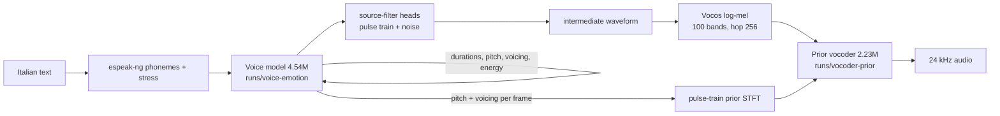

# tiny-voca-it architecture (state of 18 November 2026)

Italian text-to-speech in about 6.8M parameters: a FastSpeech2-style voice model
and a small harmonic-prior neural vocoder. This page describes what runs today and
which files hold it. How we got here, including the paths that failed, is in
`docs/analysis/quality-journey.md`. The original emotion and cloning plan is in
`docs/analysis/emotion-cloning.md`.

## Pipeline

1. **Text front end** (`tiny_voca.text`, `tiny_voca.languages`): espeak-ng
   phonemes with stress, Italian profile, about 76 symbols. Numbers and dates
   are expanded by espeak. There's no extra normaliser yet; "sig.ra", "XX
   Settembre", prices and "email" are read wrongly (see Open problems).
2. **Voice model** (`tiny_voca.model.TinyVoca`, 4.54M): transformer encoder →
   duration and pause predictor → frames → prosody stack (pitch, voicing, energy)
   → acoustic stack → **source-filter heads** that render an intermediate
   waveform (band-limited pulse train + noise, shaped by complex-cepstrum
   filters).
3. **Spectrogram:** the Vocos 24 kHz log-mel of that waveform (`losses.VocosMel`,
   bit-exact with `charactr/vocos-mel-24khz`'s extractor).
4. **Vocoder** (`tiny_voca.vocoder.Vocoder` with `prior=True`, 2.23M): the
   neural vocoder turns spectrogram + pitch into the final audio.

The intermediate waveform is not the output. It only carries exact pitch and
harmonic structure into the spectrogram. An attempt to replace it with a direct
spectrogram output was worse (quality-journey §6, "Pilot: direct spectrogram").

## Voice model (`TinyVoca`, config `configs/italian-voice-emotion.json`)

| Part | Parameters | Notes |
|---|---|---|
| Text encoder + duration/pause predictor | 1.73M | 4 transformer blocks, 192 channels, rotary attention |
| Prosody stack + head | 0.80M | 2 blocks; predicts log-F0 (relative to 200 Hz), voicing, energy |
| Acoustic stack | 1.99M | 5 blocks; conditioned on prosody |
| Source-filter heads | 0.03M | harmonic + noise cepstra, per-subframe gains |
| Emotion vectors | 0.003M | 7 labels × 192, two tables (token and frame level) |

**Conditioning:**

- **Speaker:** an embedding added at token and frame level, 12 voices:
  - IT1 (the main voice, CML-TTS speaker 1595);
  - CML4974, CML4998, CML6807, CML2033, CML1989;
  - EF1, EM1, EF2, EM2, EF3, EM3 (synthetic emotional voices).
- **Emotion:** intensity × a learned vector, at the same two places. The labels are
  neutral, joy, sadness, anger, fear, surprise and disgust. Intensity 0 or no label
  gives exactly the no-emotion output.
- **Synthesis controls:** speed, pitch shift, pitch range ("intonation"), emotion
  and intensity (`tiny_voca.infer.speak`).

**Training (current checkpoint `runs/voice-emotion/inference.pt`, step 103,292,
EMA weights):**

- **Data:**
  - 22,596 clips from 6 recorded voices (`data/it-multi6-annotations`; 4 CML
    speakers excluded for bad audio);
  - 1,749 synthetic emotional clips (`data/emotion-annotations`);
  - several manifests are combined with `--train a.jsonl b.jsonl`.
- **Losses:**
  - durations, pauses, pitch;
  - pitch spread (weight 4, against the monotone);
  - voicing, energy;
  - multi-resolution STFT and mel;
  - an auxiliary mel head;
  - the **vocoder-input loss**: an L1 between the Vocos mel of the intermediate
    waveform and of the recording (`vocos_mel_loss`, weight 10).
  - No adversarial loss.
- **History:**
  - IT1-only run to 14k (`runs/it1-full`);
  - 6 voices, 14k → 64k (`runs/voice`);
  - emotion, 64k → 103k (`runs/voice-emotion`), stopped by the overfitting guard
    (best validation at 95k).

## Vocoder (`Vocoder`, `prior=True`)

| Part | Parameters |
|---|---|
| Mel embedding conv (100 → 192, kernel 7) | 0.13M |
| Prior input (513 log-magnitudes → 192, 1×1) | 0.10M |
| 8 ConvNeXt blocks (192 channels, 576 inner) | 1.79M |
| Head (192 → 1026: 513 log magnitudes + 513 phase corrections) | 0.20M |

**Harmonic prior (`Vocoder.analyse_prior`):** a band-limited pulse train at the
frame pitch, gated by voicing, plus a 0.03 noise floor. Its STFT (1024-point, hop
256, same grid as the output) supplies two things:

- the **base phase**: output phase = prior phase + predicted correction;
- the **log magnitude**, as an extra input.

A plain Vocos-style network has to invent phase; ours starts from a source whose
harmonics advance coherently from frame to frame.

**Training (current checkpoint `runs/vocoder-prior/vocoder-0150000.pt`):**

- **Data:**
  - random 0.68 s crops of the 6 recorded voices plus the emotional set;
  - 50% of the crops use the voice model's own spectrogram as input (pairs from
    `tiny_voca.vocoder_pairs`, made with each recording's real pitch and timing)
    and the real recording as target.
- **Losses:**
  - log-mel L1 × 45;
  - multi-period + multi-resolution discriminators (least squares) + feature
    matching × 2;
  - magnitude distillation from the pretrained Vocos on the real spectrogram (×4;
    `--teacher vocos --distill-mode spectrum`). Vocos is a training-time teacher
    only.
- **History:**
  - plain Vocos-style vocoder, 0 → 100k (`runs/vocoder`);
  - Vocos distillation, 100k → 142k (`runs/vocoder-distill`; the magnitude
    converged, the phase didn't);
  - prior vocoder, 142k → 150k, paused by request. It resumes towards 184k with
    `scripts/training/alternate.sh`.

## Running it

| Task | Command / file |
|---|---|
| Listen | `scripts/playground_server.py` (port 8790): follows the newest checkpoints; choice of vocoder (ours / old DSP / Vocos), emotion, intensity, speed, intonation, 20 test sentences. From another machine use an SSH tunnel: `ssh -N -L 8790:localhost:8790 <user>@<pc>` |
| Synthesis from Python | `tiny_voca.infer.speak` → DSP waveform and details (pitch, voicing); then `VocosMel` + `load_vocoder(...)(mel, f0, voiced)` |
| Train the voice model | `python -m tiny_voca.train` (see `scripts/training/voice-emotion.sh`) |
| Train the vocoder | `python -m tiny_voca.train_vocoder` (see `scripts/training/vocoder-prior.sh`) |
| Vocoder fine-tune pairs | `python -m tiny_voca.vocoder_pairs` |
| Synthetic emotion data | `scripts/generate_emotions.py` (Qwen3-TTS VoiceDesign, English style instructions on emotional Italian text; Whisper screening) |
| GPU caps | `scripts/gpu_governor.py` (pause per step to hold ≤85% utilisation / ≤250 W) |
| Run scripts used for every run | `scripts/training/` (copies of the launch, switching and watchdog scripts) |

Some scripts use packages kept outside the project environment: `vocos` for the
teacher and reference, `qwen-tts` for emotion data, and `matplotlib` for charts.
They were installed with `pip install --target <dir>` and passed via `PYTHONPATH`,
so the training environment's `transformers` and `torch` stay untouched.

## Size and speed

- **Total parameters:** 6.77M (voice 4.54M + vocoder 2.23M).
- **Storage:** about 27 MB fp32, 13.5 MB fp16, and about 7 MB int8 [E].
- **Speed (measured, PyTorch, 2 CPU threads, GPU training at the same time):** 8.9
  s of speech in 0.51 s, about 0.06× real time.
- **Export:** the ONNX export covers the voice model, including the source-filter
  heads, the soft pulse gate, the optional post-filter and the spectral head, and the
  emotion inputs (`emotion`, `intensity`) for models that have them. With
  `--vocoder`, the neural vocoder is in the same graph: the Vocos log-mel and the
  pulse-train prior are computed with convolution STFTs, and the prior phase is
  rotated by the predicted correction without `atan2`. One file is 43 MB (fp32).
  - **Checks:** unit parity tests in `tests/test_export.py`; on the real gated model
    + vocoder 168k, durations are identical to PyTorch and the audio differs only by
    the random excitation (log-mel distance 0.16, the same as two PyTorch seeds).
  - **Speed:** ONNX Runtime on one CPU thread, 22× real time; ONNX Runtime Web
    (wasm, Node, one thread), 7.7× real time.

## Config fields added in this round (all default off; old fingerprints unchanged)

| Field | Purpose | Status |
|---|---|---|
| `max_parameters` | parameter budget check | in use (6M for some runs) |
| `excitation_jitter` | random pitch jitter in the DSP pulse train | tried, rejected (still buzzy) |
| `postfilter_channels/blocks` | 2D STFT post-filter on the DSP output | tried, rejected (worse) |
| `head_channels/blocks/fft` | frame-rate spectral head on the DSP output | tried, rejected (worse) |
| `vocos_mels` | direct 100-band mel output | tried twice (Phase 1, direct-route pilot), rejected |
| `vocos_mel_loss` | loss on the vocoder's input spectrogram | **in use** (10) |
| `emotions` | emotion labels × intensity | **in use** (7) |
| `VocoderConfig.prior` | harmonic-prior vocoder | **in use** |

## Open problems

1. **The voice model's spectrogram carries a metallic trace.** Even Vocos
   reproduces it from our spectrogram with the real pitch and timing (test **d**),
   but not from the recording's own spectrogram (test **b**). The vocoder now trains
   on these spectrograms (50% pairs), but the source is the voice model:
   - the intermediate pulse-train waveform;
   - over-smoothing from average-error losses.
2. **Emotion carries over to IT1 only partly:** pitch level for joy and anger; no
   timing change; sadness, fear and surprise barely move.
3. **The voice model is starting to overfit:** the validation − training gap grows
   from 0.04 to 0.09; the early stop ended block 2.
4. **Text normalisation:** abbreviations, Roman numerals, currency, loanwords.
5. **Browser size:** the preview graph is 43 MB in fp32; an fp16 or int8 build
   would halve or quarter the download.
